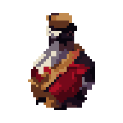
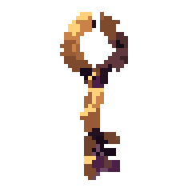
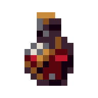
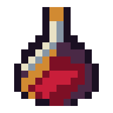

<p align="center">
  <picture>
    <source media="(prefers-color-scheme: dark)" srcset="https://shieldcn.dev/header/document.svg?title=Pixel+Art+HTML&subtitle=Craft+the+grid.+Prove+every+cell.&logo=grid3x3&theme=red&align=center&mode=dark" />
    
  </picture>
</p>

<p align="center">
  <a href="https://github.com/gvastethecreator/pixel-art-html-skill/actions/workflows/ci.yml"></a>
  <a href="https://gvastethecreator.github.io/pixel-art-html-skill/"></a>
  <a href="https://www.python.org/"></a>
  <a href="https://skills.sh/gvastethecreator/pixel-art-html-skill/pixel-art-html"></a>
  <a href="LICENSE"></a>
</p>

# Pixel Art HTML

Create exact-grid pixel art up to 512×512, including rectangular masters, with editable JSON, PNG, and standalone HTML proofs. The skill uses local deterministic tools; the compiler does not call a model API.

The default workflow is one pass: choose one direction, construct and inspect each stage once, then export and deliver with the observed limits. Alternatives require an explicit request. A requested artistic repair is one bounded intervention. A failed stage remains incomplete.

[Project site](https://gvastethecreator.github.io/pixel-art-html-skill/) · [Skill workflow](SKILLS/pixel-art-html/SKILL.md) · [Contributing](CONTRIBUTING.md)

## Install

```powershell
npx skills add gvastethecreator/pixel-art-html-skill --skill pixel-art-html
```

You can also clone this repository and install `SKILLS/pixel-art-html` through your client's skill workflow. Scripts need Python 3.11 or newer. Image conversion and reference boards need Pillow 12.3.0; exact-grid authoring and validation use the standard library.

## Start a piece

Give the agent the subject, action, dimensions, palette budget, camera, and review background. It follows the [skill workflow](SKILLS/pixel-art-html/SKILL.md), chooses a direction, and preserves up to two identity relationships.

For direct CLI use, run these commands from the repository root. A topic search retrieves construction guidance:

```powershell
python ./SKILLS/pixel-art-html/scripts/reference_library.py techniques "tree foliage volume"
```

For a defect report, use the interpreter so negated or uncertain symptoms do not become repair instructions:

```powershell
python ./SKILLS/pixel-art-html/scripts/tutorial_bridge.py diagnose "no tiene ruido pero la pose es rígida" --subject character --stage block
```

Use the [structured input contract](SKILLS/pixel-art-html/references/interpretation-contract.md) when you need to record observations, exclusions, and preservation requirements. A retrieved method is a candidate intervention, not proof of a defect.

Create a spec using the [artifact schema](SKILLS/pixel-art-html/references/artifact-schema.md), then export it:

```powershell
python ./SKILLS/pixel-art-html/scripts/build_pixel_art.py from-spec ./scene.json --project-root . --slug night-beacon
```

Managed outputs live under `pixel-art/YYYY/MM/NNN-slug/`; `pixel-art/index.html` links the project library. Use `--output <directory>` for a standalone destination. Multipart assets use [named construction parts](SKILLS/pixel-art-html/references/executable-construction.md), which preserve masks, anchors, and stage reviews.

Inspect the final HTML at native 1×, 2×, and 4×, with silhouette and value views. Validate the exact export and inspect its craft-risk report:

```powershell
python ./SKILLS/pixel-art-html/scripts/build_pixel_art.py validate ./output
python ./SKILLS/pixel-art-html/scripts/build_pixel_art.py critique ./output
```

Structural checks prove file and pixel consistency. They do not establish artistic quality. Keep the result at `draft` until the [review and promotion contract](SKILLS/pixel-art-html/references/visual-review.md) is satisfied. Final inspection records problems without starting another artistic repair loop.

## Choose a specialized route

| Need | Guide |
|---|---|
| Convert a reference image | [Source brief](SKILLS/pixel-art-html/references/image-source-brief.md) and [small-grid recovery](SKILLS/pixel-art-html/references/source-recovery.md) |
| Repair a requested relationship | [Construction workflow](SKILLS/pixel-art-html/references/construction-workflow.md) and [artistic construction](SKILLS/pixel-art-html/references/artistic-construction.md) |
| Compare explicitly requested alternatives | [Direction study](SKILLS/pixel-art-html/references/visual-review.md#direction-study); `study` requires three different same-grid drafts |
| Compose native masters into a scene | [Scene composition](SKILLS/pixel-art-html/references/scene-composition.md) |
| Build a resolution set, asset pack, or tile proof | [Commands and layouts](SKILLS/pixel-art-html/references/command-reference.md) |
| Search local text, images, GIFs, or videos | [Reference library](SKILLS/pixel-art-html/references/reference-library.md) |
| Select subject-specific construction advice | [Subject routing](SKILLS/pixel-art-html/references/subject-recipes.md) |

Asset packs include a compact showcase with integer zoom, color/value/silhouette views, background controls, and links to each exact proof and export. Large native previews scroll without being reduced below 1×.

All proof pages are self-contained and make no runtime network requests. ImageGen is optional source generation, separate from exact-grid processing. Reference media, full articles, and private indexes stay local; the package contains original synthesis and source attribution.

## Inspect the examples

Examples are reproducible drafts with documented limits. They teach construction and review decisions, not a house style or general superiority across models.

| Cursed potion | Hook key |
|---|---|
|  |  |
| **Automatic 16×16 recovery** | **Authored 16×16 repair** |
|  |  |

- [Cursed salvage](SKILLS/pixel-art-html/examples/cursed-salvage/README.md): recovery and a rejected pickup family.
- [Small-grid repairs](SKILLS/pixel-art-html/examples/small-grid-repair/README.md): constrained silhouettes and identity cues.
- [Construction repairs](SKILLS/pixel-art-html/examples/construction-repair/README.md): three original before/after cases.
- [Editable parts](SKILLS/pixel-art-html/examples/part-construction/README.md): recorded stage reviews and seven failure/repair lessons.
- [City scene](SKILLS/pixel-art-html/examples/city-clash/README.md): native masters in an interactive world canvas.

Historical revisions in these examples are not instructions to repeat artistic attempts during an ordinary request.

## Develop and verify

Use Node 20 or newer, Python 3.11 or newer, and the `packageManager` version in [package.json](package.json): pnpm 11.21.0. The package has no npm dependencies.

```powershell
python -m pip install pillow==12.3.0
pnpm run check:full
```

`check:full` validates the skill package and real method catalog, then runs the complete Python suite. It fails if Pillow is missing or a test is skipped. `check:core` selects the dependency-free tests and reports the excluded Pillow cases. Use one sufficient gate; the full gate includes the core coverage. Counts come from the runner, so documentation does not need a separate test tally.

[VS Code tasks](.vscode/tasks.json) expose the same commands without installing dependencies. CI verifies the complete gate on Windows and Ubuntu. The [contribution guide](CONTRIBUTING.md) explains when to run the optional reconstruction benchmark and how to inspect the [source-backed code map](docs/codemap/codemap.md).

## Attribution and license

Inspired by the agent-directed conversion concept in [robustonian/ai-pixel-art-converter](https://github.com/robustonian/ai-pixel-art-converter). This is an independent implementation and does not use that project's API or server code.

The craft guidance includes original synthesis from [SLYNYRD's Pixelblog catalog](https://www.slynyrd.com/pixelblog-catalogue) and the attributed sources in the [interpretation contract](SKILLS/pixel-art-html/references/interpretation-contract.md). Source-specific preferences are not universal art rules.

[MIT license](LICENSE) · [Security reports](SECURITY.md) · [Changelog](docs/CHANGELOG.md)

Support maintenance through [GitHub Sponsors](https://github.com/sponsors/gvastethecreator) or [Ko-fi](https://ko-fi.com/gvaste).
