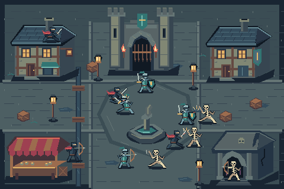

# The Square of Three Shadows

An original 480x320 still scene: four ninjas, four knights, and four skeletons in a night town. The 38 native masters share 27 colors. Six structures, streets, a drain, lanterns, and three combat encounters establish the setting. The scene is a draft example, not a game or animation.



## Build

Run from the repository root with Python and Pillow installed:

```bash
python SKILLS/pixel-art-html/examples/city-clash/build_city.py --output .local/city-clash
python SKILLS/pixel-art-html/scripts/compose_scene.py validate .local/city-clash/view
```

The output directory must be new. The builder writes editable source specs, native HTML/JSON/PNG masters, block and plane checkpoints for structures and actors, a scene manifest, and a standalone viewer. Open `view/index.html`. Use drag, wheel, the camera buttons, or keyboard arrows and Home. Faction buttons hide/show their actors and contact shadows. The proof selector shows values or actor silhouettes.

The camera computes backing dimensions from `window.devicePixelRatio`; `1×` uses one backing pixel per source cell. This can appear smaller than one CSS pixel per cell. Check the actual browser presentation at its viewport and DPR; the calculation does not certify every screen. The native PNG remains 480x320.

## Construction decisions and criticism

This is independent geometry, palette, composition, and character art. No reference pixels were sampled. A city-building process informed the separation of roof, walls, openings, and edge treatment. A night castle image informed contrast allocation. Their specific buildings, creature, colors, and composition were not reproduced. The methods are attributed in the portable technique library.

Ninjas use compact cloth bodies, masks, red trailing scarves, and thin blades. Knights use broad shields, steel helmets, teal tabards, and braced feet. Skeletons use open rib cages, thin limbs, skull gaps, and uneven weapons. Color reinforces these structural differences.

The first scene had three relationship failures: the eastern shield bearer faced away from its attacker; the rooftop ninja's feet sat below the eave; a skeleton appeared over the crypt roof. The current placement changes facing, contact height, and depth. It also gives the lower ninja and skeleton a shared blade contact. Ground shadows are separate so the actor silhouette proof preserves foot gaps.

Remaining limits: the architecture uses a simplified oblique projection; some small joints and the central blade contact are crowded; repeated human proportions remain visible. Mirrored figures retain stylized lighting. The scene is useful evidence for composition and camera behavior, not proof that the skill now produces finished art for every subject.
