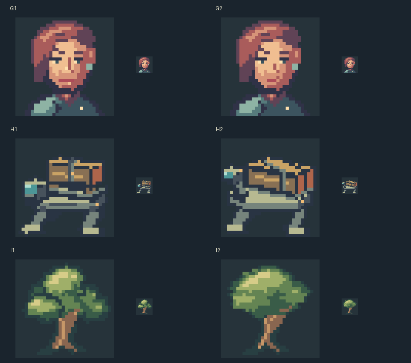

# Construction repairs after the first improvement

These three original examples teach diagnosis and controlled reconstruction. They are drafts, not a house style or finished-art targets. Use the decisions for a new brief; do not copy their silhouettes or pixels when original work is requested.

All masters are 32x32. The portrait and carrier keep a ten-color budget; the tree keeps seven. The earlier and later grids use the same authored palette. No third-party image pixels or extracted palettes enter these examples.



## What the review found

An independent model reviewer first preferred these earlier drafts over weaker drawings. Reviewing them alone then exposed substantial remaining problems. The final comparison above uses only the two closer versions; it does not use the weakest original as the standard.

| Pair | Region and observed defect in the earlier draft | Intervention | Independent comparison and remaining limit |
|---|---|---|---|
| G: portrait | Face, x11..21/y10..22: bright fragments compete with the eyes; the mouth becomes a rigid band. | Group cheek and nose values; remove the nasal glint and shorten the mouth band while keeping the pose. | G2 preferred, with a moderate improvement in expression hierarchy. The far brow remains heavy; whether the more severe expression fits requires a character brief. |
| H: carrier | Crate and frame, x9..29/y5..23: broken edges obscure which faces belong to one volume. | Give the crate continuous faces; separate its pallet from a continuous chassis and an integrated front cab. | H1 preferred for clearer load faces. The crate-to-frame support remains less clear than the crate itself; the repair also loses some oblique orientation. |
| I: tree | Crown, x2..29/y1..19: three similar round light islands behave like separate balls. | Build one dominant irregular canopy with quieter extensions and a shared underside. | I2 preferred for organic mass hierarchy. Its denser shadow hides more of the bifurcation, a tradeoff that depends on the intended tree design. |

These are observations from one non-builder model reviewer, not human acceptance or a population study. No score certifies the result. `comparison.json` records canonical grid fingerprints and exact deltas; a changed-cell count does not measure quality.

## Rebuild a comparison

From the skill folder, choose one of `portrait`, `mech`, or `oak`. For example:

```bash
python scripts/build_pixel_art.py from-spec examples/construction-repair/mech-before.json --output <work>/before --scale 1
python scripts/build_pixel_art.py repair <work>/before/pixel-art.json examples/construction-repair/mech-after.json --output <work>/after --scale 1
python scripts/pixel_lab.py loupe <work>/before/pixel-art.json --compare <work>/after/pixel-art.json --region 8 5 22 19 --output <work>/load-comparison.png
python scripts/build_pixel_art.py validate <work>/after
```

Open the generated HTML at native size and on the intended background. First judge the current piece alone, then compare the intervention. The detailed method is in [artistic-construction.md](../../references/artistic-construction.md).
