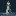
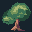
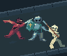

# Original parts, observed revisions

These three original studies test editable part masks, declared contacts, and reviews between block, planes, and material. They do not copy reference pixels or reproduce a reference composition. The lighthouse is 16x16 with an eight-color limit, the wind tree is 32x32 with nine, and the three-faction encounter is 96x80 with sixteen.

| Lighthouse | Wind tree | Encounter |
|---|---|---|
|  |  |  |

## Inspect the recorded work

Run from any directory with Python and the skill's declared Pillow dependency:

```bash
python <skill-dir>/examples/part-construction/build_demo.py --output work/recorded-construction
```

Open the generated `index.html`. It links all three part viewers, recorded stages, seven visual lessons, and an encounter canvas with pan and zoom. Every generated page is standalone. The scene export checks that padding tiny masters preserves every world pixel.

[build_demo.py](build_demo.py) replays the exact sources and historical self-reviews in [recordings](recordings). This is reproduction of recorded work, not a fresh observation. The original sequence included rejected blocks, two rejected canopy shadows, and a return to block after an independent reviewer found the skeleton's support and overlapping weapon paths unclear. Winning lineages are embedded in the recordings; [lessons.json](lessons.json) retains selected losing and revised grids with their original source fingerprints.

## Seven conditional lessons

Read the lesson that matches the observed failure. Each entry gives a cause, intervention, what to preserve, a limit, and a visual question. These are seven local lessons from three studies, not seven independent evaluations.

| Observed failure | Visual pair | Transferable decision |
|---|---|---|
| Lantern consumes the tower | [lantern-mass](previews/lantern-mass.png) | Allocate rows to the main form before its small identity cue. |
| Crown closes a trunk opening | [trunk-gap](previews/trunk-gap.png) | Protect a chosen negative space in the responsible mask. |
| Shadow reads as a hollow dome | [canopy-turn](previews/canopy-turn.png) | Place shadow where the form turns away from light. |
| A patch leaves the wrong dark ring | [failed-light-patch](previews/failed-light-patch.png) | Replace the faulty boundary instead of decorating inside it. |
| Ground swallows actor silhouettes | [environment-silhouette](previews/environment-silhouette.png) | Separate environment in the diagnostic view without changing occlusion. |
| Feet fall beyond the deck | [sole-support](previews/sole-support.png) | Test a declared support point against the actual support mask. |
| Parallel weapons lose ownership | [weapon-ownership](previews/weapon-ownership.png) | Separate action paths; recheck how much of each weapon remains visible. |

The weapon revision is partial: the shortened knight blade has little visible area. The lighthouse shaft remains irregular, and some tree highlights form steps. These examples teach diagnosis and controlled revision; they do not establish finished production art.

## Work through the authored sources

[create_sources.py](create_sources.py) contains the original geometric and surface decisions for these examples. It is not a generator for arbitrary subjects. For a new brief, author different masses and poses.

```bash
python <skill-dir>/examples/part-construction/create_sources.py --output work/block-sources
```

Compile and inspect a block with `construct.py`. Make an actual review before creating the next pass. The source builder accepts `--stage planes --base work/block-sources --output work/plane-sources`, then material from the observed plane source directory. It creates no review records. Use the [executable construction guide](../../references/executable-construction.md) for review and edit commands.
